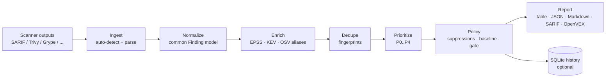

# findings-hub — Design (draft v0.1)

> Working name: **findings-hub**, binary `fhub`. Real product name is TBD before public launch.

## 1. Problem & promise

Small teams run 3–6 security scanners (Trivy, Grype, Semgrep, gitleaks, Checkov, Dependabot…).
Each speaks its own format, they overlap, and severity alone says nothing about real risk.
Result: hundreds of alerts, CI gates everyone disables, and nobody knows what actually matters.

**Promise:** *"Feed it every scanner's output. Get back the handful of findings that matter,
a CI gate people don't turn off, and an audit trail of everything you decided to accept."*

Principles:
- **Doesn't scan, it decides.** We orchestrate and judge other scanners' output; we never compete with them.
- **Single binary, offline-capable, zero telemetry.** Works air-gapped after one data sync.
- **Stateless first.** `fhub check` in CI needs no database or server. State (history, dashboard) is opt-in.
- **Dogfood.** Our own releases ship signed, with an SBOM and provenance.

## 2. Pipeline



## 3. Data model (normalized `Finding`)

| Field | Notes |
|---|---|
| `fingerprint` | Stable ID used for dedupe, baselines and suppressions (see §4) |
| `kind` | `vuln` (dependency), `code` (SAST), `secret`, `iac`, `misconfig` |
| `sources[]` | Which scanners reported it + their original rule IDs |
| `vuln_ids[]` | CVE, GHSA, OSV… aliases; one **canonical ID** (prefer CVE) |
| `package` | ecosystem, name, version, PURL, fixed_version, scope (prod/dev) |
| `location` | file, start/end line, artifact (image, lockfile) |
| `severity` | Normalized: critical/high/medium/low/info (+ original CVSS if present) |
| `epss` | score + percentile (FIRST.org) |
| `kev` | in CISA KEV?, date added, known ransomware use |
| `priority` | P0–P4 computed (§5), plus human-readable *reasons* |
| `status` | open / suppressed / baselined / fixed |
| `first_seen`, `last_seen` | When history is enabled |
| `context` | repo, branch, commit, CI run URL |

**Secrets are never stored.** Secret findings keep only a salted hash of the value for fingerprinting.

## 4. Deduplication (fingerprints)

| Kind | Fingerprint inputs | Why |
|---|---|---|
| vuln | PURL (name+version) + canonical vuln ID | Trivy says GHSA-x, Grype says CVE-y: OSV aliases join them |
| code | SARIF `partialFingerprints` if present, else rule + file + hash of normalized line content | Survives code moving up/down a file |
| secret | rule + file + hash(secret) | Same secret in same file = one finding |
| iac/misconfig | rule + file + resource ID | |

Merged findings keep **all** sources (two scanners agreeing raises confidence).

## 5. Prioritization (defaults, overridable in policy)

| Priority | Default rule | Meaning |
|---|---|---|
| **P0** | in KEV, **or** EPSS ≥ 0.4 and severity ≥ high, **or** secret | Exploited / likely exploited: fix now |
| **P1** | EPSS ≥ 0.1, **or** critical | Fix this sprint |
| **P2** | high | Plan it |
| **P3** | medium | Backlog |
| **P4** | low / info | Ignore unless cheap |

Modifiers: dev-only dependency → down one level; no fix available → flagged (not downgraded).
Every priority comes with reasons, e.g. `P0: CVE-2024-3094 is in CISA KEV (added 2024-03-29)`.

## 6. Policy file — `.fhub.yaml`

```yaml
version: 1

gate:
  fail_on: [P0]             # priorities that fail the build
  new_only: true            # only fail on findings not in the baseline
  ignore_dev_dependencies: true

prioritize:                 # optional overrides of §5
  epss_p0_threshold: 0.4

suppressions:
  - id: CVE-2023-12345
    package: pkg:npm/lodash
    reason: "We never call _.template(); not reachable."
    expires: 2027-01-31     # required: no permanent ignores
    vex:
      status: not_affected
      justification: vulnerable_code_not_in_execute_path
```

Rules: every suppression needs a `reason` and `expires`. Expired suppressions reactivate the
finding and are called out loudly. Suppressions double as **OpenVEX** statements.

**Baseline** (`.fhub-baseline.json`, committed to the repo) lets a team adopt `fhub` on a legacy
codebase: "fail only on *new* P0s" from day one, and burn down the old ones over time.

## 7. CLI surface

| Command | Purpose | Version |
|---|---|---|
| `fhub check <files…>` | Ingest → enrich → dedupe → gate. Exit 1 on policy failure. **The CI command.** | v0.1 |
| `fhub db update` | Refresh EPSS / KEV / OSV cache (offline after this) | v0.1 |
| `fhub baseline create` | Snapshot current findings into the baseline file | v0.1 |
| `fhub explain <fingerprint\|CVE>` | Why is this P0? All sources, scores, reasons | v0.1 |
| `fhub vex export` | Suppressions → OpenVEX document | v0.2 |
| `fhub ingest` / `fhub history` | Store runs in SQLite, show trends, new/fixed | v0.2 |
| `fhub serve` | Local web dashboard (embedded in the binary) | v0.3 |

Output formats: `table` (default for terminals), `json`, `markdown` (PR comments), `sarif`
(upload to GitHub code scanning), `openvex`.

## 8. Supported inputs

| Input | v0.1 | Later |
|---|---|---|
| SARIF 2.1.0 (Semgrep, CodeQL, gitleaks, Checkov, Trivy, …) | ✅ | |
| Trivy JSON | ✅ | |
| Grype JSON | ✅ | |
| CycloneDX / SPDX SBOM (match against OSV ourselves) | | v0.2 |
| Dependabot alerts (GitHub API) | | v0.3 |

Format is auto-detected from content, not file extension.

## 9. Enrichment data sources (all free)

| Source | Use | Refresh |
|---|---|---|
| FIRST EPSS (daily bulk CSV) | Exploit probability per CVE | daily |
| CISA KEV (JSON feed) | Known exploited vulns | daily |
| OSV.dev (API / bulk) | GHSA ↔ CVE aliases, fixed versions | on demand, cached |

Cache: `~/.cache/fhub` (OS-appropriate). Integrity-checked, with a max age; `--offline` uses the cache only and
warns if stale. Exact feed URLs are verified at implementation time (EPSS moved hosts in 2025).

## 10. Code layout

```
findings-hub/
├── cmd/fhub/              # main + cobra commands
├── internal/
│   ├── model/             # Finding, Severity, Priority
│   ├── ingest/            # detect.go, sarif/, trivy/, grype/
│   ├── enrich/            # epss/, kev/, osv/, cache.go
│   ├── dedupe/            # fingerprints + merge
│   ├── prioritize/        # rules engine, reasons
│   ├── policy/            # .fhub.yaml load/validate, suppressions, baseline, gate
│   ├── report/            # table, json, markdown, sarif, openvex
│   └── store/             # SQLite (v0.2)
├── testdata/              # REAL scanner outputs → golden-file tests
├── action.yml             # GitHub Action wrapper (v0.2)
├── .goreleaser.yaml       # cross-platform builds, signing, SBOM
└── docs/
```

## 11. Tech choices

| Choice | Pick | Why |
|---|---|---|
| Language | Go 1.27 | Ecosystem standard (Trivy/Grype), single static binary |
| CLI | cobra | De-facto standard, completions, help |
| DB | SQLite via `modernc.org/sqlite` | Pure Go, so no CGO and trivial cross-compiling |
| Config | `gopkg.in/yaml.v3` | |
| Web UI (v0.3) | Go templates + htmx, embedded | No Node build chain, still one binary |
| Release | GoReleaser + GitHub Actions + cosign (keyless) + SBOM | Free; signed releases sell a security tool |
| Tests | Table-driven + golden files from real scanner runs | Parsers are where bugs hide |

## 12. Open-core boundary

| Free (Apache-2.0) | Pro / Team (paid license) |
|---|---|
| Entire CLI, all parsers, enrichment, gate, baseline, VEX | Multi-repo server dashboard |
| Single-repo history + local dashboard | SSO / RBAC, audit log |
| GitHub Action | Jira / Slack / Teams integrations |
| | Compliance evidence reports (EU CRA, SOC 2) |

Licensing: offline **Ed25519-signed license keys** checked locally. No license server, so no hosting cost.

## 13. Roadmap

- **v0.1 (≈2 weeks):** `check`, `db update`, `baseline`, `explain`; SARIF/Trivy/Grype; EPSS+KEV+OSV; table/JSON/Markdown output.
- **v0.2:** SQLite history, OpenVEX, SBOM ingest, GitHub Action, GoReleaser signed releases, docs site (GitHub Pages).
- **v0.3:** `fhub serve` dashboard, trends, Dependabot import. **Start talking to users here.**
- **v0.4:** Pro tier: multi-repo server, SSO, Jira/Slack, CRA report.
- **Later:** CI/CD workflow hardening module (GitHub Actions / GitLab CI misconfigurations).

## 14. Open decisions

1. **Product name.** Needs to be decided before the first public release (domain/GitHub org availability).
2. **Policy language.** Plain YAML rules (proposed) vs. CEL expressions (more powerful, used by Kubernetes). Proposal: YAML now, CEL as an advanced option later.
3. **P0 thresholds.** EPSS ≥ 0.4 is a starting guess; tune against real data from your own projects.
